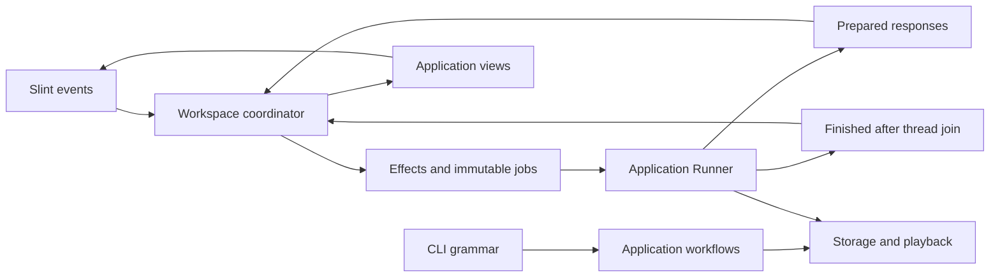

# Architecture

Auditory Lab has a pure synthesis core, shared application capabilities, and CLI and Slint frontends. Frontends translate terminal or widget events and render application-owned vocabulary, reports and views.

| Package | Responsibility |
| --- | --- |
| [`auditorylab-core`](../crates/core) | Portable recipes, validation, deterministic seekable/live synthesis, facts, timing models and waveform reduction; `no_std` with `alloc`. |
| [`auditorylab`](../crates/app) | Snapshots, editing, library storage, file publication, playback sessions, reports, vocabulary, workspace coordination and its job runner. Core APIs are exposed through `auditorylab::core`. |
| [`auditorylab-cli`](../crates/cli) | clap grammar, terminal layout, output encoding, interrupts and exit codes. |
| [`auditorylab-gui`](../crates/gui) | Slint models/windows, native dialogs and platform integration, and driving workspace effects/completions. |
| [`xtask`](../xtask) | Build identity, notices, native icons, archives and package checks. |

## Sound model

| Term | Meaning |
| --- | --- |
| Recipe | Portable document with identity/history, description, sources, evidence, lineage and a Sound. |
| Sound | Authored duration, fade and ordered Components. |
| Component | Stable owner ID and one ComponentForm. |
| ComponentForm | A Voice, BinauralPair or MonauralPair. |
| Voice | Ear routing, peak level, carrier and optional modulation. |
| Target | A Sound compiled at one sample rate, without a finite envelope. |
| Signal | A validated Target plus a finite envelope; directly seekable. |
| Rendition | An immutable recipe snapshot realized at one rate. |
| Method | The shared structural vocabulary for requested and generated rhythm facts. |

`Sound::check(rate)` retains component diagnostics; `target(rate)` and `signal(rate)` require a valid complete candidate. Lowering pairs into identified voice lanes is private compilation. The limits are 16 authored components, 16 expanded voices and 32 crossfade slots.

Recipe parsing enforces bounded UTF-8 TOML, supported schema, identity and finite numeric structure. Finite acoustic errors remain inspectable and editable. Export checks its chosen rate; playback checks the actual device rate during preparation. `ParameterId` supplies semantic fields and units, with the same parameter attribution used by errors and editing.

Integer phase, binary64 arithmetic and portable `libm` define sample determinism. The pinned [digest tests](../crates/core/tests/determinism.rs) cover unchanged sample bits. Voice order, pulse onset/width rounding and the finite raised-cosine envelope are part of that contract; the [recipe guide](recipes.md#waveforms) defines the formulas. RIFF/RF64 export converts rendered samples to stereo binary32.

## Editing and workspace

`RecipeSnapshot` owns immutable content, origin and a process-local identity. It caches nominal facts and two rate-specific realization successes/errors. Search indexes typed identity, metadata, structural terms and numeric quantities independently of display prose. One `CatalogQuery` and `LibraryKey` drive discovery, scopes, selection, sorting and grouping.

`EditorSession` owns committed content, staged text, cached analysis and the saved-content baseline. A parsed finite candidate commits atomically; invalid text or nonfinite values preserve every staged field. Save needs serializable content; export/playback also need their respective acoustic checks. Saving a captured snapshot never clears newer edits.

Opaque `RowKey` strings identify document, component and generation. Remove and Undo advance the component generation. Application admission rejects stale field and structural commands, even if a GUI delegate survives or is reused. Surviving row lifetimes retain their nested models, focus and caret.

The workspace coordinator owns prompts, pending actions and close decisions over library, editor, audio and file sub-states. Every workspace binds a library or an explicit unavailable-library state; unavailable storage leaves Built-ins usable and refuses managed writes. Typed statuses retain semantic outcomes/errors until views render them.

There is one audio slot and one file slot. Save/import can run beside audio; export needs idle audio. Stop targets audio, and Cancel export targets only export. Slots remain occupied until their threads have joined. Pending actions wait only for their own dependencies; expected stop/cancellation is cleanup, while failures block affected continuations. Save-before-close also requires the same document and no newer unsaved content. Repeated Quit shares one decision.

The coordinator emits jobs and consumes typed responses; it does not spawn or join threads. `Runner` owns execution and reports final outcomes after join. Shutdown requests Stop, cancels an export, finishes admitted saves/imports, suppresses new continuations and reports actual failures. The GUI drives that same boundary.

## Storage and publication

The library layout contains `library.toml`, plain `recipes/<uuid>.toml` and `trash/<uuid>.toml`, timestamp-only `membership.toml`, `.library.lock` and private `.stage/`. Exact recipe bytes determine the lowercase SHA-256 token. Directory location determines active/Trash state; missing dates are Unknown. A recipe is published before its membership dates, so interruption can lose a timestamp while leaving readable content.

Managed mutations hold one exclusive cooperative lock through read, optional expected-token check, publication and verification. CLI expectations are optional; the GUI supplies the token it observed. Scans are read-only and bounded, retain healthy results when incomplete, and expose path-specific Needs-review diagnostics for undecodable files. Unknown files are retained. A locked write removes orphan membership rows and recognized abandoned stages.

One capability-directory publisher handles WAV, recipe export, library writes and external Save. It creates an exclusive adjacent stage, writes and synchronizes it, checks cancellation and publishes with no-clobber linking or atomic replacement. Pre-publication hashing is cancellable; post-publication verification preserves publication truth. Candidate bytes after an ambiguous I/O result mean saved with a warning; previous bytes mean not applied; other/unreadable content is a path-specific error. Directory synchronization and cleanup warnings remain successful saves.

Trash/Restore use a no-clobber link then unlink. Same-file duplicates after interruption retain Trash authority; the next locked write removes only the redundant active name. Different files sharing a UUID require reconciliation. Purge is attributed by absence after unlink under the exclusive lock.

External Save preserves the opened file's identity and creation history and rechecks its identity/hash immediately before replacement. Other writers can race after that check. Managed library operations preserve external originals. Copies receive a fresh identity and scoped ancestry; dates are declared/observed values rather than inferred filesystem or publication dates.

## Playback and observations

One atomic outcome word decides terminal playback truth. Stop before completion is stopped; failure can win from an active state; dropping an unfinished owner records abandonment. Source generation, backend-submitted frames and estimated output position remain separate. Sources stop at `Signal::MAX_FRAMES`. Output conversion uses channels 0/1 and silences additional channels.

A live Engine uses fixed slots and 30 ms ramps/glides/crossfades between validated targets. Matching identities retain phase. An audio-equivalent requested revision updates facts without a transition; other updates coalesce behind a current transition. The accepted-target control mailbox uses a nonblocking callback `try_lock`; it retains the accepted/pending control contract.

Callbacks allocate/free nothing, perform no I/O and never wait. Monitor publication uses an indexed SPSC sample ring and a coherent latest-state triple buffer. A stalled reader drops samples with counted gaps. The sole reader owns bounded history and drains only through its published state watermark, keeping samples and observations coherent. Monitoring gaps and backend underruns are distinct; session counters and terminal outcomes stay authoritative independently of visualization.

`WaveformCapture` is an immutable sample/quantity/provenance snapshot; Hold retains it across edits, navigation and new sessions. Static timing models describe origin-zero structure; generated observations describe actual frames and transition roles. They report audio schedules and generated samples. Hearing safety still depends on device volume, listening duration and headphones/speakers. The release callback cost check measures median software cost; actual backend underruns remain visible during playback.

## Native integration and delivery

Native accessibility, keyboard focus and clipped-field/caret reveal belong to the [minimal toolkit fixes](../third_party/README.md). macOS Quit passes through the workspace Save/Discard/Cancel decision before native termination. File dialogs are parented and expose Stop independently from their file operation.

Typography uses platform SystemUi, AppKit system size, Windows message metrics at 96 DPI, and toolkit Xft scaling on X11. A scale-only GNOME Wayland reader handles text preferences without doubling X11 scaling. Preference work stays off audio/UI hot paths.

Build identity derives from the workspace manifest, root LICENSE metadata and an optional validated source revision. [Packaging](releasing.md) generates notices, native icons and archives, extracts them, checks identity/content/architecture and runs host smoke checks. The recipe, library-layout and CLI-output formats are documented in the [recipe](recipes.md) and [CLI](cli.md) guides.
