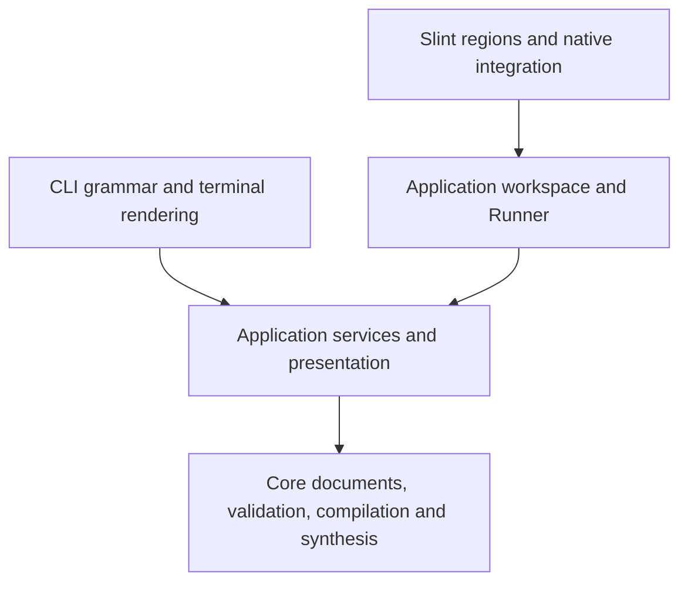

# Architecture

Auditory Lab separates pure documents/synthesis, application operations and frontend mechanics.

| Owner | Responsibility |
| --- | --- |
| [Core](../crates/core/src/lib.rs) | `no_std + alloc` recipes, identities, shared validity/rhythm rules, compilation, finite/live rendering, timing and reduction. |
| [Document](../crates/app/src/document) | Immutable snapshots/renditions, editable drafts, staged text and saved baselines. |
| [Discovery](../crates/app/src/discovery) | Typed queries, correlation, unique groups, ordering and calendar input. |
| [Services](../crates/app/src/services) | Source resolution, complete listing, inspection, portable text, library lifecycle, export and playback preparation. |
| [Workspace](../crates/app/src/workspace) | Owned substates, admission, immutable effects/jobs, prompts, pending actions and close decisions. |
| [Storage](../crates/app/src/storage) / [audio](../crates/app/src/audio) | Private filesystem/publication and native-device/session adapters. |
| [Presentation](../crates/app/src/presentation) | Shared sentences, typed error explanations, reports and waveform views. |
| [CLI](../crates/cli/src) / [GUI](../crates/gui/src) | Requests, rendering, terminal interrupts or native windows/dialogs. GUI chrome belongs to the GUI. |
| [xtask](../xtask/src) | Identity, notices, icons, distributions and extracted-package checks. |

Frontends call services/workspace and consume their public data. Native adapters stay private. Domain enums own labels and display-order lists; GUI choice models and callback indexing use those same lists. The CLI owns exit codes and hints. Core/application errors retain typed rule values, paths and original causes; presentation renders them.

## Document and audio invariants

- `Recipe` is built only through checked construction/parsing. It preserves finite structure, unique owners, budgets and metadata references; acoustic validity at a rate remains separate.
- `ComponentId` is a nonzero authored owner. `VoiceId` adds its generator lane. [Structure checking](../crates/core/src/authored.rs) owns uniqueness and both budgets; [compilation](../crates/core/src/compiled.rs) retains the component while creating lanes and diagnostics.
- Seekable `Signal` and transition-oriented `Engine` share [synthesis formulas](../crates/core/src/synthesis.rs). [Equivalence tests](../crates/core/tests/live_equivalence.rs) compare steady frames with a negative control. [FiniteSource](../crates/core/src/finite.rs) owns finite Stop fading.
- [Rhythm analysis](../crates/core/src/rhythm.rs) shares rules between rate-independent authored settings and realized observations. Pair relationships remain explicit.
- Callback code allocates/frees nothing, performs no I/O and never waits. The live mailbox uses `try_lock`; monitoring uses bounded SPSC samples and coherent state publication. Visual gaps and backend underruns remain distinct.

## Interactive ownership

`EditorState`, `LibraryState`, `AudioState`, `FileState`, `OutputState` and `Prompts` own their admission and transitions. The coordinator handles cross-state capture, effects and continuations. Actions and view availability use the same preparation. Staged nonfinite/unparseable text remains available for correction; newer edits remain dirty after an earlier save.

`RowKey` binds document, component and generation. Removing/restoring rows advances their UI lifetime; stale callbacks cannot mutate replacements. Snapshots memoize nominal facts, canonical text and bounded rate-specific realizations.

[Runner](../crates/app/src/workspace/tasks.rs) executes immutable jobs and delivers final results after joining. A result or terminal playback phase does not release its slot. Stop and export cancellation target separate resources. Pending actions wait for their captured dependencies; actual failure blocks affected continuation. Repeated Quit shares one Save/Discard/Cancel decision.

Slint [Library](../crates/gui/ui/library-pane.slint), [Workbench](../crates/gui/ui/workbench-pane.slint), [dialogs](../crates/gui/ui/dialogs.slint) and [transport](../crates/gui/ui/transport.slint) use explicit properties/callbacks. The [window shell](../crates/gui/ui/main.slint) retains the adapter-facing API and layout coordination. The adapter translates identities/models and drives effects.

## Persistence and observations

Managed mutation checks run against locked state. Services cannot replace the adapter’s expected-token, identity/history, no-clobber or postcondition checks. Selection capabilities grant managed authority; retained provenance alone does not. External Save rechecks opened identity/bytes but can race an uncooperating writer after its final check.

One atomic terminal outcome owns playback truth. Generated frames, backend-submitted frames and estimated output position stay separate. Held captures retain samples, source, rate, span, observation, scale and meters together. Timing models describe origin-zero structure; generated observations describe actual frames and transition roles.

[Formats](formats.md) owns schema/layout/JSON/exit-code reference. [Toolkit integration](../third_party/README.md) defines authenticated patches and retirement checks; [packaging](releasing.md) defines native prerequisites and delivered-content verification.

Shared research views, authored-component descriptions, copy-attribution notes and parameter help are constructed in [presentation](../crates/app/src/presentation/recipe_text.rs). Core keeps typed records and copy scope/history rules; a fork takes an explicit nonempty attribution note. Domain term enums provide heading labels and running-text phrases from one vocabulary match.
