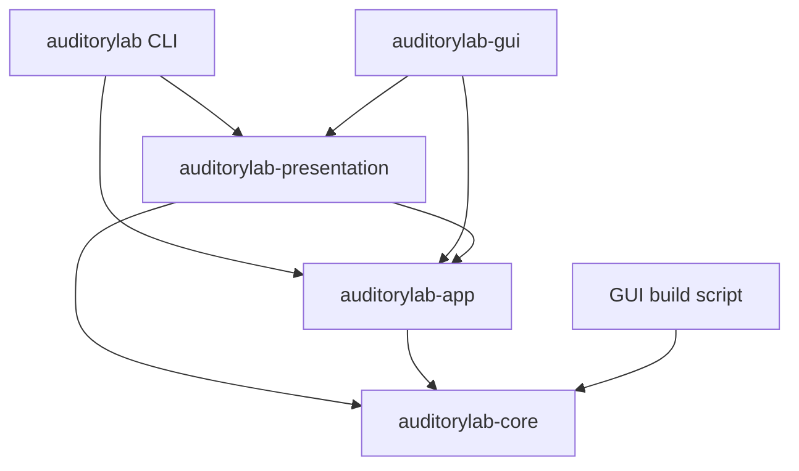
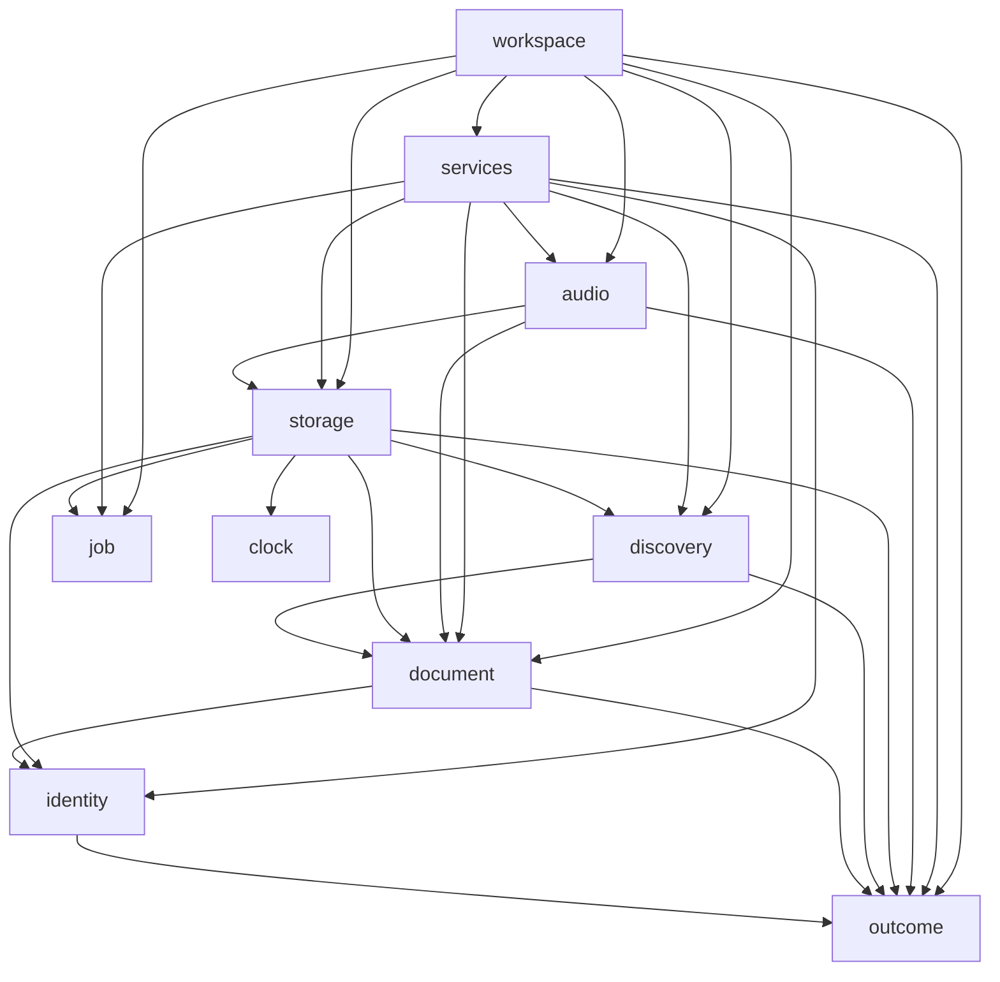

# Architecture

Auditory Lab keeps authored documents, application coordination and human presentation in separate Rust owners. Arrows point from a consumer to its dependency; toolkit and serialization dependencies are omitted here.

Inside app, a module may name a lower owner. These are the direct production dependencies:

## Owners

### Core contracts and rendering

[Core](../crates/core/src/lib.rs) is `no_std + alloc`. It owns portable `Recipe`/`RecipeContent`, checked `Sound` and `ComponentForm`, finite numbers, validation, classification, compilation and synthesis. `ComponentId` identifies an authored component; `VoiceId` adds a generator lane. The lowered `Voice` is private. `Finite` equality and hashing preserve signed-zero bits.

Sources are grouped under `model/`, `analysis/` and `render/`; public types and module entry points are exported from the crate root. The [component schema](../crates/core/src/model/component_schema.rs) owns wire fields, quantity metadata, units, intrinsic rules and applicability. It generates the strict component decoder and parameter interfaces. Build portable edits with `into_builder()` and `build()` to enforce the recipe contract.

[Core vocabulary](../crates/core/src/model/vocabulary.rs) owns shared keys and domain terms, including facet absence labels and persisted title/copy defaults. GUI-only chrome belongs to the GUI. `Operation` supplies shared operation keys and terms; interface punctuation belongs to each frontend.

The core `Code` contract supplies fixed diagnostic identifiers and structured parameters. Owner declarations generate enumerable registries. Wrappers delegate to typed causes; human explanations are rendered separately. The checked reference tables are in [formats](formats.md#diagnostic-codes).

### Application data and operations

[Document](../crates/app/src/document) owns immutable snapshots/renditions, editable drafts, staged input and saved baselines. [Origin](../crates/app/src/document/origin.rs) owns catalog/user/temporary keys, exact-byte conflict tokens and opened-file identity. [Input](../crates/app/src/document/input.rs) owns editable numeric grammar in display units. Snapshots memoize canonical text, nominal facts and bounded rate-specific realizations without caching presentation views.

[Discovery](../crates/app/src/discovery) executes correlated queries, unique groups and deterministic ordering. Query types own defaults and reset semantics. Core owns the choice enums, keys and terms. App resolves local calendar boundaries; presentation formats instants.

[Services](../crates/app/src/services) expose source resolution, listing, inspection, portable text, library lifecycle, export and playback preparation. `LibraryContext` captures one configured path, precedence source and configuration result. CLI commands and GUI bindings retain that context. Actions still validate current filesystem state; configuration availability does not cache admission. WAV export can accept the exact inspected `Rendition` through `export_rendition`.

[Storage](../crates/app/src/storage) and [audio](../crates/app/src/audio) are private adapters. Storage enforces locks, file identity, byte limits, publication and ambiguous postconditions. Audio owns native preparation, streams, terminal outcomes and bounded monitor publication. Public device failures use app-owned variants and opaque `BackendError` sources; native CPAL types remain inside the adapter.

[Clock](../crates/app/src/clock.rs), [identity](../crates/app/src/identity.rs), [outcome](../crates/app/src/outcome.rs) and [job controls](../crates/app/src/job.rs) own observed time, identity/build metadata, result categories and cancellation/progress/replacement policy. Root Cargo metadata owns product display identity; LICENSE owns legal terms.

### Interactive workspace

[Workspace](../crates/app/src/workspace) coordinates document, library, file, audio, output and prompt state. State-changing user input passes through `Workspace::apply(Command)`; typed responses return admitted work and prompt decisions. App owns the only typed view tree, including monitor/control models and defaults.

`EntryHandle` binds a library action to its listing lifetime, indexed content version and membership. Stale or foreign handles are refused before admission. `EntryMutation` identifies the requested mutation; purge additionally requires a typed confirmation response. Slint entry addresses retain immutable per-render handle tables through gestures.

Runtime `ChoiceView` options carry keys and selected state. The adapter resolves callbacks through the actual rendered options. Rhythm navigation joins count metadata by key and carries explicit addresses into that same choice table. Headings and scope/date display flags read captured typed query state. Control indexes do not define query meaning. Advanced query edits validate dates and facets atomically; full-filter reset and reveal effects discard pending native input.

An injected `Executor` owns execution and joining. `Runner::new` supports explicit polling; a runner configured with a waker posts preparation and joined completion notifications. Its completion observer starts before the actual worker and joins that worker before posting the terminal response. Observers are reaped on later polls/admissions and all are joined at shutdown. A task slot cannot be released by an unjoined result.

The GUI coalesces worker, bounded export-progress and native-preference notifications through Slint's event loop. Its repeating redraw timer runs only for bound audio or a visible monitor. macOS motion changes arrive through the NSWorkspace notification center. Projection counters measure the production path used by GUI tests.

### Presentation and frontends

[Presentation](../crates/presentation/src/lib.rs) owns sentences, research/About text, help, error explanations and JSON report objects. Render functions and extension traits consume app/core data. String-only `*Text` bundles describe one typed row or projection; they do not copy identities, child structure or admission flags. `Explain` retains human context independently of machine codes, and report serialization owns JSON escaping.

[CLI](../crates/cli/src) owns grammar, terminal I/O, interrupts, exit-status mapping and CLI hints. [GUI](../crates/gui/src) owns windows/dialogs, Slint model reconciliation, focus, layout and chrome. Both render through presentation. The GUI build script reads core vocabulary and GUI terms without app/audio build dependencies; it generates the parameter enum and mappings from `ParameterId::ALL`.

[xtask](../xtask/src) owns native resources, notices, distributions and independent extracted-package checks. [Packaging](releasing.md) defines its supported inputs and delivered contents.

## Invariants and checks

- Authored numbers are finite, and equality/hash preserve signed-zero bits: [rejects_nonfinite_values_and_preserves_finite_bits](../crates/core/src/model/finite.rs).
- Sound construction and mutation preserve unique positive owners and both budgets: [raw_component_budget_and_duplicate_owners_are_checked_at_the_authored_boundary](../crates/core/src/model/authored/tests.rs).
- Nonfinite TOML fails at the actual field key with line/column context; unknown/duplicate fields remain rejected: [nonfinite_format_errors_locate_the_actual_component_and_modulation_fields](../crates/core/src/model/recipe/tests.rs) and [strict format checks](../crates/core/src/model/recipe/tests.rs).
- Seeking and finite/live rendering preserve the defined sample bits: [every_kind_of_component_renders_the_same_bits_on_every_platform](../crates/core/tests/determinism.rs), [seek properties](../crates/core/tests/seek.rs), and [every_builtin_matches_bit_for_bit_after_both_startup_envelopes](../crates/core/tests/live_equivalence.rs) with its different-carrier negative control.
- Committing a candidate is atomic across staged fields: [commit_is_atomic_over_the_whole_candidate](../crates/app/src/document/editing/tests.rs). An unedited display callback preserves model bits even when unit conversion has no exact binary64 inverse: [committing_an_unedited_display_preserves_unrepresentable_finite_model_bits](../crates/app/src/document/editing/tests.rs).
- A row handle binds document, authored owner and UI generation; removed/restored controls cannot accept retired callbacks: [retired_component_callbacks_stay_retired_after_undo](../crates/gui/src/adapter_tests.rs).
- Captured saves keep later edits independent, and final results cannot release a running worker slot: [save_before_close_waits_for_the_captured_job_completion](../crates/app/src/workspace/tests.rs) and [real_file_result_waits_for_thread_exit_before_releasing_save_and_close](../crates/app/src/workspace/tasks/tests.rs).
- Publication verifies candidate, previous and foreign bytes after ambiguous I/O; stale external identity refuses even a no-op save: [postcommit_failures_verify_candidate_previous_and_foreign_content](../crates/app/src/storage/publish/tests.rs) and [stale_bytes_or_same_bytes_in_a_new_file_refuse_even_noop_save](../crates/app/src/storage/external/tests.rs).
- The render callback performs no allocation/free, I/O or waiting; bounded waveform publication is checked at the maximum slot count: [maximum_rate_waveform_callback_does_not_allocate_or_free_at_32_slots](../crates/app/src/audio/session/monitor/tests.rs).
- The first terminal session result is retained; later supervision cannot replace it with a timeout: [a_published_terminal_outcome_is_never_replaced_by_a_timeout](../crates/app/src/audio/session/supervisor.rs).

External Save checks opened identity/bytes immediately before replacement; an uncooperating writer can still race the final check. Unix adapters explicitly synchronize directory entries; non-Unix adapters issue no separate directory-sync operation. Native filesystem guarantees remain platform-specific.

Generated frames, backend-submitted frames and estimated output position are distinct counters. A held capture retains samples, source, rate, span, observation, scale and meters together. Timing models project an origin-zero target; generated observations describe actual frames and transition roles. Preview, accepted model and generated output are labeled independently.

## Change guides

### Add a component kind

Declare its wire fields, parameter meaning and allowed shared fields in the [component schema](../crates/core/src/model/component_schema.rs). The schema generates forms, the strict visitor, quantity access, units and intrinsic rules. Define lowering, validation and voice facts, then classification/timing where applicable. Preserve authored order, owner/lane identity and serialization field order. Add independent structure/sample/rejection cases. Workspace chooses applicable controls and typed diagnostics; presentation supplies descriptions, while the GUI maps the resulting rows. The GUI build script generates `ParameterKey` and its mappings from `ParameterId::ALL`.

### Add a CLI command

Put shared operation policy and typed failures in the appropriate app owner/service. Define the CLI grammar and category-to-exit/hint handling in CLI. Use presentation-owned reports or explanations and its JSON byte serializer. Check the actual executable's output and relevant failures; a confirmed file operation remains confirmed if output writing fails.

### Add a GUI control

Define shared quantity meaning and terms in core. Put control ranges/defaults in [workspace controls](../crates/app/src/workspace/controls.rs), admission and state changes in app, wording in presentation, and geometry/focus/chrome in Slint. Send a typed `Command` and project app views into retained models. Use opaque row/field handles and rendered facet-option keys; preserve pending input across unrelated projections. Sound validity and save readiness remain app/core decisions.

### Add a recipe field

Define its meaning and checked construction in core, including equality and strict serialization. Update the schema/limits, source relationships and public getters together. Preserve or explicitly change the format contract, with independent round-trip/rejection cases. Editing stages untrusted text until the complete candidate can commit; presentation renders the resulting typed field and cause.

## Test and format boundaries

App unit suites assert typed state, views and causes. The real-waker GUI test delivers file completion through Slint’s event proxy with the redraw timer stopped and independently checks notification coalescing. Presentation unit suites and [integration tests](../crates/presentation/tests) assert wording through the public app API. Presentation is compiled as its own crate for every consumer. Core’s `test-support` feature supplies shared behavioral recipe builders through dev-dependencies; normal application graphs exclude it. The app dependency tree contains no presentation crate.

[Formats](formats.md) owns schema/layout/JSON/exit-code reference. [Toolkit integration](../third_party/README.md) defines authenticated patches and replacement contracts; [packaging](releasing.md) defines native prerequisites and delivered contents. Core's sample tests use independent numerical expectations; xtask's version/package expectations remain independent from the product's formatters.
