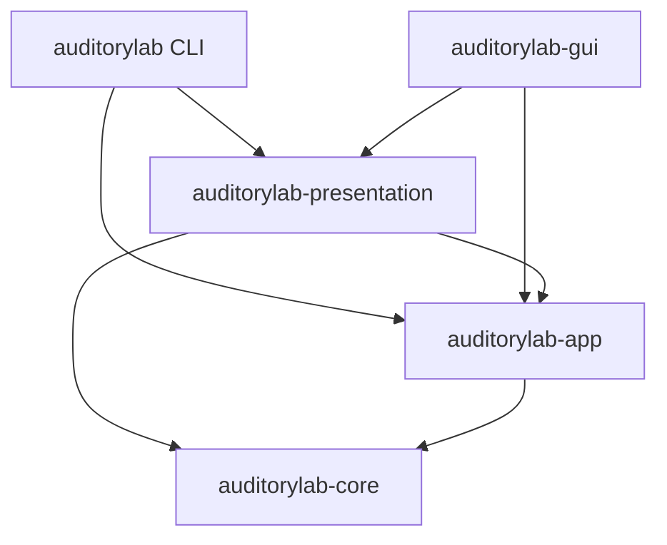

# Architecture

Auditory Lab separates authored sound and research, application decisions, and rendering. Arrows point from a consumer to its dependency; toolkit and serialization dependencies are omitted.

## Crates and owners

- [Core](../crates/core/src/lib.rs) is `no_std + alloc`: portable recipes, sound/research invariants, validation, structural analysis and synthesis. Its ordinary module tree groups [model](../crates/core/src/model/mod.rs), [analysis](../crates/core/src/analysis/mod.rs) and [rendering](../crates/core/src/render/mod.rs). Everyday types have one public root path; `catalog`, `provenance`, `vocabulary`, `diagnostic`, `rhythm`, `timing`, `live`, `waveform` and `finite_source` are namespaced families.
- [App](../crates/app/src/lib.rs) owns application decisions: editable documents, discovery, library/file operations, device preparation and interactive coordination. Private storage and audio adapters enforce rules against the resources used by the action.
- [Presentation](../crates/presentation/src/lib.rs) owns rendering. `sound`, `recipe`, `library`, `workspace` and `numbers` expose typed free functions. The `errors` tree owns every `Explain` implementation, the presentation trait for polymorphic error chains. `report` owns machine JSON. It calls human renderers for diagnostic messages and schema-3 group display captions; group keys and membership stay independent.
- [CLI](../crates/cli/src/main.rs) owns argument grammar, terminal I/O, interrupts and exit mapping. It passes explicit library overrides through the app constructor and renders app outcomes through presentation.
- [GUI](../crates/gui/src/adapter.rs) owns desktop chrome, native windows/dialogs, focus, layout and reconciliation of retained Slint models. Its build script sees GUI-owned chrome, Slint and validated product metadata; it has no core or app build dependency.
- [xtask](../xtask/src/main.rs) owns contributor gates, dependency notices, native resources, archives and independent extracted-package checks. [Packaging](releasing.md) defines supported inputs and deliverables.

A term lives with the type that gives it meaning. [Core vocabulary](../crates/core/src/model/vocabulary.rs) describes sound, research and portable document terms. [App vocabulary](../crates/app/src/vocabulary.rs) describes operations, statuses, query absence and application views. Discovery owns [query choices](../crates/app/src/discovery/query.rs), with defaults, reset behavior and execution in [collection queries](../crates/app/src/discovery/collection.rs). Desktop-only wording stays in [GUI terms](../crates/gui/src/terms.rs). Labels never identify commands or records. Both owners participate in the checked [diagnostic and vocabulary references](formats.md).

The built-in [catalog](../crates/core/src/model/catalog.rs) contains curated condition/study lists. Requesting an entry merges its study citation and shared limitation into standalone schema-5 TOML without comments. Directory/order tests check the lists; [catalog documentation](catalog.md) supplies explanations.

Root [Cargo.toml](../Cargo.toml) owns product name, copyright and version. Build readers share metadata validation. About and executable version text belong to [build-info presentation](../crates/presentation/src/build_info.rs); native version fields derive from the version. LICENSE supplies legal terms independently.

## Authored and compiled boundaries

`Sound` owns ordered components; `FiniteTiming` independently owns finite duration and overall fade in `RecipeContent`. Finite editable candidates can be serialized with diagnostics. Only a checked `Target` contains compiled components; `Signal` adds resolved finite timing. `CompiledComponent` owns source lanes and one shared modulation plan. The live component slot owns one modulation clock, origin and transition progress, including both pair lanes. Component order is retained after settlement; source-kind tags force atomic structural transitions. Rendering allocates nothing, locks nothing and performs no I/O.

[Pulse intent](../crates/core/src/model/pulse.rs), [resolved pulse queries](../crates/core/src/render/pulse.rs), [source compilation](../crates/core/src/render/source.rs), [acoustic failures](../crates/core/src/render/error.rs), [digital routing](../crates/core/src/model/routing.rs) and compositional analysis have separate responsibilities. Requested facts travel with their generator. Pair differences derive from integer phase-step differences, not rounded displayed carrier frequencies. Static previews use generator extrema; output captures remain actual pre-conversion samples.

Application construction/defaults belong to [document construction](../crates/app/src/document/construction.rs), independently of slider ranges. [Editor bindings](../crates/app/src/document/editing/bindings.rs), [portable drafts](../crates/app/src/document/editing/draft.rs), [candidate analysis](../crates/app/src/document/editing/candidate.rs) and [session transactions](../crates/app/src/document/editing/session.rs) are separate. The analysis cache includes sound, finite timing and sample rate. Numeric grammar and display conversion belong to `document::input`. Native [projection/reconciliation](../crates/gui/src/adapter/projection.rs) is separate from window/effect lifecycle.

Menu admission requires the current row generation. Field admission uses the birth generation of its continuously applicable semantic interpretation: surviving fields retain pending text and caret across unrelated changes; removed/reintroduced fields cannot accept old callbacks, including away/back and undo. Related rate/window staging participates atomically in pulse interpretation edits; unrelated staging stays staged. No UI range or display string defines authored defaults or acoustic validity.

## One desktop command end to end

An **Export WAV** click follows this path:

1. The Slint control receives an app-issued `ActionView` and a presentation-rendered label. Its callback becomes `Command::File(FileCommand::ExportWav)`; the adapter supplies no validity or admission rule.
2. [Workspace commands](../crates/app/src/workspace/commands.rs) route through the file part's typed request. The coordinator checks prompts, pending work and both task slots. The library or editor part prepares captured content at the selected export rate.
3. The coordinator emits `Effect::ChoosePath`. The native panel returns `Command::Answer { prompt, answer }`; stale answers change nothing. Admission is checked again against current state before work starts.
4. The coordinator captures a file job and emits `Effect::Run`. [Runner](../crates/app/src/workspace/tasks.rs) executes the service on a worker. Storage publishes with cancellation, conflict and no-clobber protections.
5. The executor joins the worker before delivering `Response::Finished`. `Response::Prepared` is the separate audio-preparation response; frontend answers never enter `respond`.
6. The coordinator records typed outcomes, continues pending work and advances its revision. `poll` refreshes captures/models and `take_effects` drains requested frontend work.
7. Command/response completion runs `poll` before draining effects and projecting, so closed-monitor models do not depend on a redraw timer. The adapter receives typed views, renders their text through presentation and updates retained Slint models. Callback handles keep their original document/component or listing lifetime across unrelated projections.

Library, editor, audio and file parts keep their fields private and accept their own typed commands/transitions. The coordinator alone owns cross-part admission, prompts, pending document actions, close/exit, effects and job context. `Workspace` implementations are confined to `mod.rs` and `commands.rs`.

Every menu uses an app-issued `ChoiceView`. Per-render tables retain the actual typed choices; callbacks select an offered option, not a domain `ALL` array. Field rows carry opaque `FieldHandle` strings. An absent route has no selection. Shared operation labels and accessible names arrive before first show, and an exhaustive operation match forces each GUI binding decision.

## One CLI command end to end

For `auditorylab list --collection builtin --band alpha --format json`:

1. Clap translates stable argument keys into app query types. An explicit `--library-dir` is validated by `LibraryContext::from_override`; environment/default configuration retains the app's non-failing resolution behavior.
2. [Discovery services](../crates/app/src/services/discovery.rs) capture indexed recipe summaries. [Query execution](../crates/app/src/discovery/collection.rs) owns correlation, defaults, matching, sorting, grouping and unique-key counts. Listing opens no audio device.
3. The CLI selects the JSON renderer in [report](../crates/presentation/src/report.rs), whose `json_bytes` serializer preserves the machine contract independently of human sentences.
4. The CLI writes the bytes and maps the app outcome to the documented exit status. A relative explicit root is rejected before dispatch; an unusable absolute root remains a captured configuration diagnostic.

## Where changes go

### Add a component kind or recipe field

Define authored structure in [authored types](../crates/core/src/model/authored.rs), located nested decoding in [component tables](../crates/core/src/model/component_codec.rs), and semantic units/rules in [parameter metadata](../crates/core/src/model/parameter_schema.rs). Compile atomic components and their associated facts in core; source adaptation is bounded and shared modulation has one authority. Preserve authored order, owner/lane identity and sample contracts. Add independent structure, sample, round-trip and rejection expectations.

Portable metadata belongs in the recipe contract, including checked construction and strict serialization. [Document editing](../crates/app/src/document/editing.rs) stages untrusted text and commits the complete candidate atomically. The app projects applicable fields and diagnostics; presentation renders them. The GUI consumes handles and choices without generating parameter enums or copying defaults.

### Add a query choice or application operation

Put query meaning, defaults and reset behavior in discovery; put its application terms in the app vocabulary. Core must not name library, workspace, file-dialog or transport concepts. Update both checked format-reference tables where keys/codes change. New shared operations require app admission/projection and an exhaustive GUI binding.

### Add a CLI command or desktop control

Put shared policy and typed failures in the app owner/service. The CLI supplies grammar and I/O; a desktop control supplies geometry, focus and platform interaction. Use typed commands, current admission and opaque app handles. Reuse presentation functions for shared wording and keep interface punctuation local. Test actual executable output or production GUI bindings, including refusals and stale gestures.

### Change rendering or packaging

Choose one presentation subject. Keep JSON schema logic in `report`; human rendering is limited to diagnostic messages and the shared group-caption contract in [formats](formats.md#cli-json-output). Keep GUI sizing alternatives with GUI controls. Package changes belong in xtask and [release guidance](releasing.md), with extracted-content checks on the matching native OS/CPU.

## Shared terms

| Term | Meaning |
| --- | --- |
| Recipe | Portable document identity/history, authored sound and attributed research. |
| Component | One identified source relationship with one shared modulator; pairs cost two generator lanes. |
| Target | Sound validated and compiled at one sample rate, without a finite envelope. |
| Signal | Target plus its finite duration and edge envelope. |
| Snapshot | Immutable captured recipe with an origin and memoized interpretation. |
| Rendition | Captured snapshot with its checked finite signal. |
| Nominal analysis | Authored rhythmic meaning, independent of device realization. |
| Observation | Facts about generated frames and transition roles. |
| EntryHandle | Listing lifetime plus indexed identity/version and membership. |
| FieldHandle | Document/component lifetime plus the addressed editable field. |
| ChoiceView / ActionView | App-issued options or an operation with current availability. |
| Effect / Response | Requested external work versus executor preparation/joined completion. |

## Invariants and checks

- Authored numbers are finite, and equality/hash preserve signed-zero bits: [rejects_nonfinite_values_and_preserves_finite_bits](../crates/core/src/model/finite.rs).
- Sound construction and mutation preserve unique positive owners and both budgets: [raw_component_budget_and_duplicate_owners_are_checked_at_the_authored_boundary](../crates/core/src/model/authored/tests.rs).
- Nonfinite TOML fails at the actual field key with line/column context; unknown/duplicate fields remain rejected: [nonfinite_format_errors_locate_the_actual_component_and_modulation_fields](../crates/core/src/model/recipe/tests.rs) and [strict format checks](../crates/core/src/model/recipe/tests.rs).
- Seeking and finite/live rendering preserve the defined sample bits: [every_kind_of_component_renders_the_same_bits_on_every_platform](../crates/core/tests/determinism.rs), [seek properties](../crates/core/tests/seek.rs), and [every_builtin_matches_bit_for_bit_after_both_startup_envelopes](../crates/core/tests/live_equivalence.rs) with its different-carrier negative control.
- Committing a candidate is atomic across staged fields: [commit_is_atomic_over_the_whole_candidate](../crates/app/src/document/editing/tests.rs). An unedited display callback preserves model bits even when unit conversion has no exact binary64 inverse: [committing_an_unedited_display_preserves_unrepresentable_finite_model_bits](../crates/app/src/document/editing/tests.rs).
- A field handle binds document, authored owner and semantic field lifetime; removed/restored controls cannot accept retired callbacks: [retired_component_callbacks_stay_retired_after_undo](../crates/gui/src/adapter_tests.rs).
- Captured saves keep later edits independent, and final results cannot release a running worker slot: [save_before_close_waits_for_the_captured_job_completion](../crates/app/src/workspace/tests.rs) and [real_file_result_waits_for_thread_exit_before_releasing_save_and_close](../crates/app/src/workspace/tasks/tests.rs).
- Publication verifies candidate, previous and foreign bytes after ambiguous I/O; stale external identity refuses even a no-op save: [postcommit_failures_verify_candidate_previous_and_foreign_content](../crates/app/src/storage/publish/tests.rs) and [stale_bytes_or_same_bytes_in_a_new_file_refuse_even_noop_save](../crates/app/src/storage/external/tests.rs).
- The render callback performs no allocation/free, I/O or waiting; bounded waveform publication is checked at the maximum slot count: [maximum_rate_waveform_callback_does_not_allocate_or_free_at_32_slots](../crates/app/src/audio/session/monitor/tests.rs).
- The first terminal session result is retained; later supervision cannot replace it with a timeout: [a_published_terminal_outcome_is_never_replaced_by_a_timeout](../crates/app/src/audio/session/supervisor.rs).
- Catalog lists match condition/study directories and preserve ordering: [catalog tests](../crates/core/src/model/catalog/tests.rs).
- Both diagnostic registries and all vocabulary keys match the format reference: [diagnostic registry](../crates/presentation/tests/diagnostic_registry.rs) and [vocabulary reference](../crates/presentation/tests/vocabulary_reference.rs).
- First-show operation text has an accessible name: [window tests](../crates/gui/src/window_tests.rs).

App tests assert typed state, views and causes. GUI suites install production callbacks on an offscreen platform; the real-waker test also covers completion with the redraw timer stopped. Presentation suites retain wording assertions through the public app API. Core's dev-only `test-support` feature supplies behavioral fixtures, while numerical expectations and negative controls remain independent.

External saves recheck opened identity/bytes immediately before replacement; an uncooperating writer can still race the final check. Publication states its access: library records are owner-only, exported files follow the process umask, and a replaced external file keeps its permissions. Native filesystem guarantees remain platform-specific. Generated frames, submitted frames and estimated output position are distinct counters; held captures retain their samples and provenance together. Timing models describe origin-zero targets, while observations describe actual generated frames.

[Formats](formats.md) owns schema/layout/JSON/exit contracts. [Toolkit integration](../third_party/README.md) records authenticated patches and retirement conditions. [Contributing](../CONTRIBUTING.md) lists executable gates and the review checklist.
