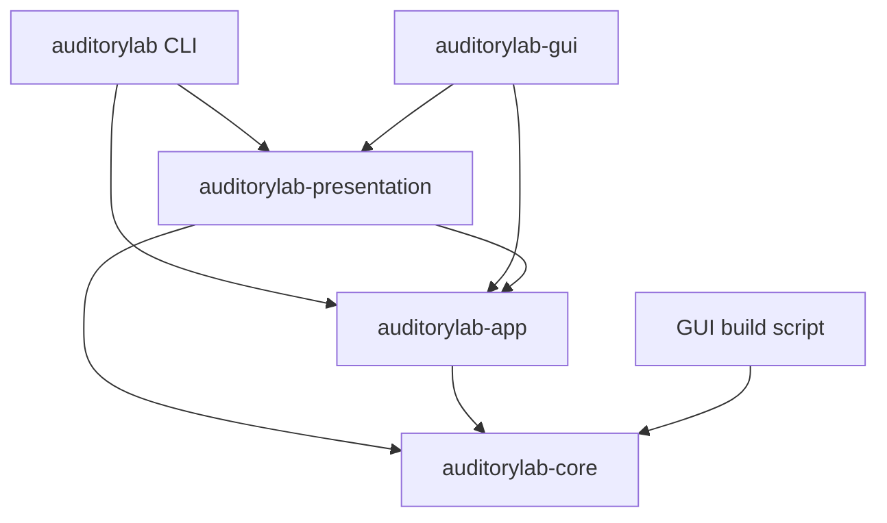
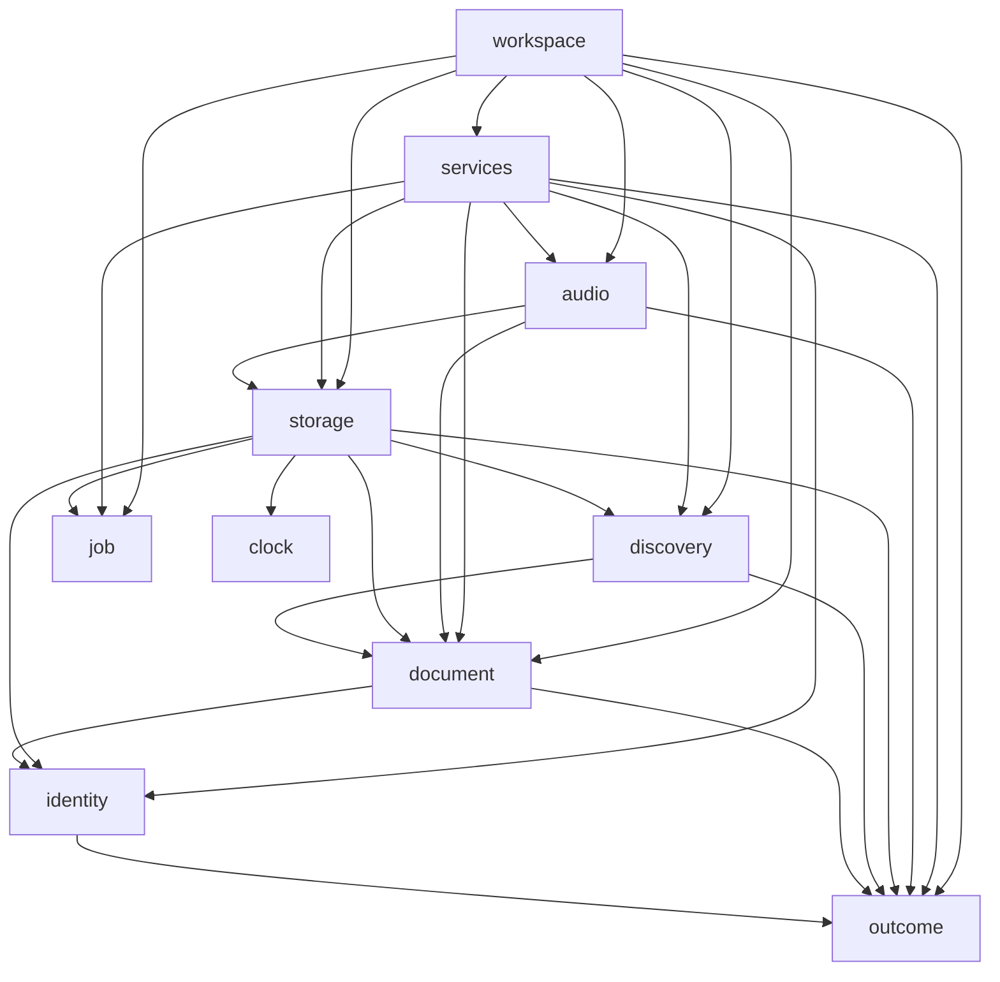

# Architecture

Auditory Lab keeps authored documents, application coordination and human presentation in separate Rust owners. Arrows point from a consumer to its dependency; toolkit and serialization dependencies are omitted here.

Inside app, a module may name a lower owner. These are the direct production dependencies:

## Owners

[Core](../crates/core/src/lib.rs) is `no_std + alloc`. It owns `Recipe`, bitwise-equal `RecipeContent` and `Finite`, checked `Sound`, flat authored `ComponentForm`, owner/lane identities, the shared vocabulary and pure validation, rhythm, compilation, synthesis, timing and reduction. `ComponentId` identifies an authored owner; `VoiceId` adds a generator lane. The private lowered `Voice` is a generator definition rather than another authored model. Source directories group authored contracts under `model/`, classification and timing under `analysis/`, and compilation and sample generation under `render/`; types and established module entry points are exported at the crate root.

[Clock](../crates/app/src/clock.rs), [identity](../crates/app/src/identity.rs), [outcome](../crates/app/src/outcome.rs) and [job controls](../crates/app/src/job.rs) are app leaves. They own observed time, identity allocation/build metadata, frontend-independent result categories and cancellation/progress/replacement policy. Product display metadata comes from the workspace manifest; legal text remains in LICENSE.

[Document](../crates/app/src/document) owns immutable snapshots/renditions, editable drafts, staged input and saved baselines. [Origin](../crates/app/src/document/origin.rs) owns catalog/user/temporary keys, exact-byte conflict tokens and retained file identity. `CatalogId` validates name grammar in core; lookup separately establishes that an entry exists. [Input](../crates/app/src/document/input.rs) owns editable numeric grammar in display units. Snapshots retain typed content and memoize canonical text, nominal facts and bounded rate-specific realizations; they do not cache presentation views.

[Discovery](../crates/app/src/discovery) executes queries, correlated facets, unique groups and deterministic ordering. Core owns the pure choice enums, keys and labels. Its `vocabulary::Operation` supplies shared operation terms and serialized report keys; interface punctuation stays in the frontend. App resolves native calendar boundaries and local instants; presentation formats those instants.

[Storage](../crates/app/src/storage) and [audio](../crates/app/src/audio) are private adapters. Storage checks actual locked/observed state, file identity, byte limits, no-clobber publication and ambiguous postconditions. Audio owns native preparation, stream lifetime, terminal outcomes and bounded monitor publication. Each owner retains its typed errors and original causes. Public device failures contain app-owned variants and opaque `BackendError` sources; CPAL types stay inside the adapter. The core `Code` contract supplies fixed identifiers and structured parameters; owner declarations also generate enumerable code lists. Transport wrappers delegate to typed causes. Display is independent of the machine contract.

[Services](../crates/app/src/services) expose source resolution, complete listing, inspection, portable text, library lifecycle, export and playback preparation. They aggregate operation errors without redefining lower-layer rules. `LibraryContext` captures one configured path, precedence source and configuration result. Library services share it; GUI binding retains it. Configuration availability does not cache filesystem admission: each action still checks current locks/layout/content. A service preflight does not replace checks at the filesystem or device action. The CLI exports the rendition it inspected through `export_rendition`.

[Workspace](../crates/app/src/workspace) coordinates editor, library, file, audio, output and prompt substates. It owns admission, captured jobs, continuations and typed views. `EntryMutation` carries row mutations without action-name strings; purge follows a typed prompt response. Editor/selection/monitor views preserve kinds, identities, issues and rates until rendering. An injected `Executor` starts and polls jobs and joins owned work during shutdown; `Runner` implements real thread execution. Final responses require a join before releasing a slot. Projection counters record the same work in production and GUI tests.

[Presentation](../crates/presentation/src/lib.rs) owns sentences, research/About views, help, error explanations and JSON report objects. Extension traits and free functions render app/core data; `Explain` preserves human context separately from stable error codes. Report serialization owns JSON escaping. Persisted title/copy defaults belong to core vocabulary because they are document content. Recipe edits use `into_builder()`, modify the candidate, then `build()` to enforce the portable contract. Monitor captures/models and control defaults belong to workspace because they are application data.

[CLI](../crates/cli/src) owns grammar, terminal I/O, interrupts, the category-to-exit-status table and CLI hints. [GUI](../crates/gui/src) owns native windows/dialogs, Slint model reconciliation and GUI chrome. Both render through presentation. The GUI build script reads owning core vocabulary enums and GUI-only terms; it does not build app/audio as build dependencies. [xtask](../xtask/src) owns native resources, notices, distributions and independent extracted-package checks.

## Invariants and checks

- Authored numbers are finite, and equality/hash preserve signed-zero bits: [rejects_nonfinite_values_and_preserves_finite_bits](../crates/core/src/model/finite.rs#L65).
- Sound construction and mutation preserve unique positive owners and both budgets: [raw_component_budget_and_duplicate_owners_are_checked_at_the_authored_boundary](../crates/core/src/model/authored/tests.rs#L1170).
- Nonfinite TOML fails at the actual field key with line/column context; unknown/duplicate fields remain rejected: [nonfinite_format_errors_locate_the_actual_component_and_modulation_fields](../crates/core/src/model/recipe/tests.rs#L580) and [strict format checks](../crates/core/src/model/recipe/tests.rs).
- Seeking and finite/live rendering preserve the defined sample bits: [every_kind_of_component_renders_the_same_bits_on_every_platform](../crates/core/tests/determinism.rs#L117), [seek properties](../crates/core/tests/seek.rs), and [every_builtin_matches_bit_for_bit_after_both_startup_envelopes](../crates/core/tests/live_equivalence.rs#L7) with its different-carrier negative control.
- Committing a candidate is atomic across staged fields: [commit_is_atomic_over_the_whole_candidate](../crates/app/src/document/editing/tests.rs#L76). An unedited display callback preserves model bits even when unit conversion has no exact binary64 inverse: [committing_an_unedited_display_preserves_unrepresentable_finite_model_bits](../crates/app/src/document/editing/tests.rs#L1094).
- A row handle binds document, authored owner and UI generation; removed/restored controls cannot accept retired callbacks: [retired_component_callbacks_stay_retired_after_undo](../crates/gui/src/adapter_tests.rs#L1018).
- Captured saves keep later edits independent, and final results cannot release a running worker slot: [save_before_close_waits_for_the_captured_job_completion](../crates/app/src/workspace/tests.rs#L947) and [real_file_result_waits_for_thread_exit_before_releasing_save_and_close](../crates/app/src/workspace/tasks/tests.rs#L194).
- Publication verifies candidate, previous and foreign bytes after ambiguous I/O; stale external identity refuses even a no-op save: [postcommit_failures_verify_candidate_previous_and_foreign_content](../crates/app/src/storage/publish/tests.rs#L136) and [stale_bytes_or_same_bytes_in_a_new_file_refuse_even_noop_save](../crates/app/src/storage/external/tests.rs#L65).
- The render callback performs no allocation/free, I/O or waiting; bounded waveform publication is checked at the maximum slot count: [maximum_rate_waveform_callback_does_not_allocate_or_free_at_32_slots](../crates/app/src/audio/session/monitor/tests.rs#L802).
- The first terminal session result is retained; later supervision cannot replace it with a timeout: [a_published_terminal_outcome_is_never_replaced_by_a_timeout](../crates/app/src/audio/session/supervisor.rs#L170).

External Save checks opened identity/bytes immediately before replacement; an uncooperating writer can still race the final check. Unix adapters explicitly synchronize directory entries; non-Unix adapters issue no separate directory-sync operation. Native filesystem guarantees remain platform-specific.

Generated frames, backend-submitted frames and estimated output position are distinct counters. A held capture retains samples, source, rate, span, observation, scale and meters together. Timing models project an origin-zero target; generated observations describe actual frames and transition roles. Preview, accepted model and generated output are labeled independently.

## Change guides

### Add a component kind

Declare its wire fields, parameter meaning and allowed shared fields in the [component schema](../crates/core/src/model/component_schema.rs). The schema generates forms, the strict visitor, quantity access, units and intrinsic rules. Define lowering, validation and voice facts, then classification/timing where applicable. Preserve authored order, owner/lane identity and serialization field order. Add independent structure/sample/rejection cases. Workspace chooses applicable controls and typed diagnostics; presentation supplies descriptions, while the GUI maps the resulting rows. The GUI build script generates `ParameterKey` and its mappings from `ParameterId::ALL`.

### Add a CLI command

Put shared operation policy and typed failures in the appropriate app owner/service. Define the CLI grammar and category-to-exit/hint handling in CLI. Use presentation-owned reports or explanations and its JSON byte serializer. Check the actual executable's output and relevant failures; a confirmed file operation remains confirmed if output writing fails.

### Add a GUI control

Define the quantity or shared term at its owning core enum when it is shared. Put convenience ranges/defaults in [workspace controls](../crates/app/src/workspace/controls.rs), admission/state changes in workspace and wording in presentation. Bind opaque row/field handles through the adapter. Slint owns geometry, focus and chrome; it does not decide sound validity or save readiness.

### Add a recipe field

Define its meaning and checked construction in core, including equality and strict serialization. Update the schema/limits, source relationships and public getters together. Preserve or explicitly change the format contract, with independent round-trip/rejection cases. Editing stages untrusted text until the complete candidate can commit; presentation renders the resulting typed field and cause.

## Test and format boundaries

App unit suites assert typed state, views and causes. Presentation unit suites and [integration tests](../crates/presentation/tests) assert wording through the public app API. Presentation is compiled as its own crate for every consumer. Core’s `test-support` feature supplies shared behavioral recipe builders through dev-dependencies; normal application graphs exclude it. The app dependency tree contains no presentation crate.

[Formats](formats.md) owns schema/layout/JSON/exit-code reference. [Toolkit integration](../third_party/README.md) defines authenticated patches and replacement contracts; [packaging](releasing.md) defines native prerequisites and delivered contents. Core's sample tests use independent numerical expectations; xtask's version/package expectations remain independent from the product's formatters.
